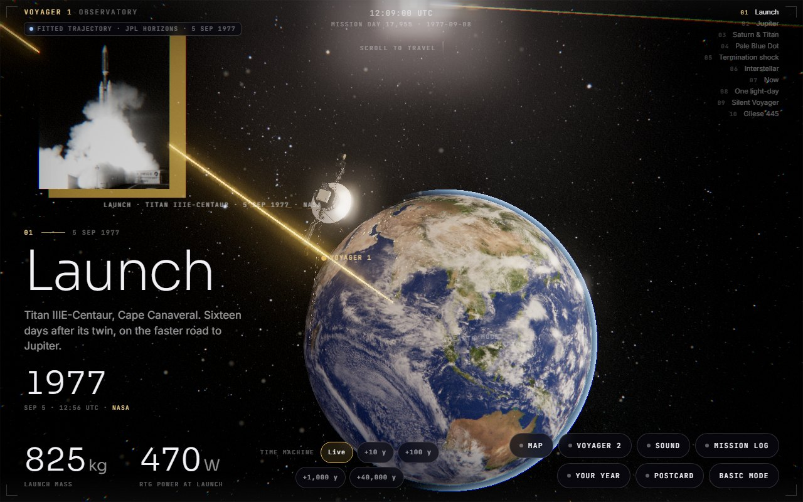
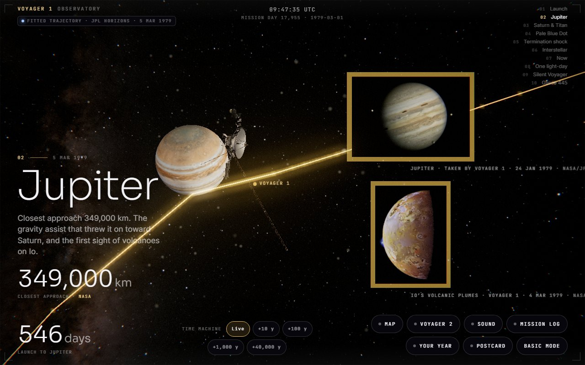
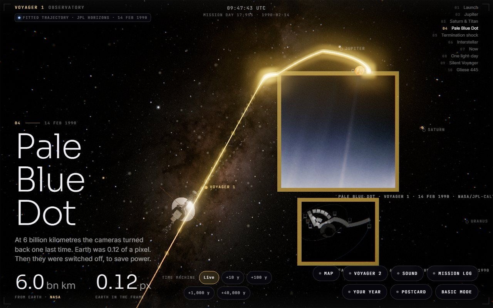
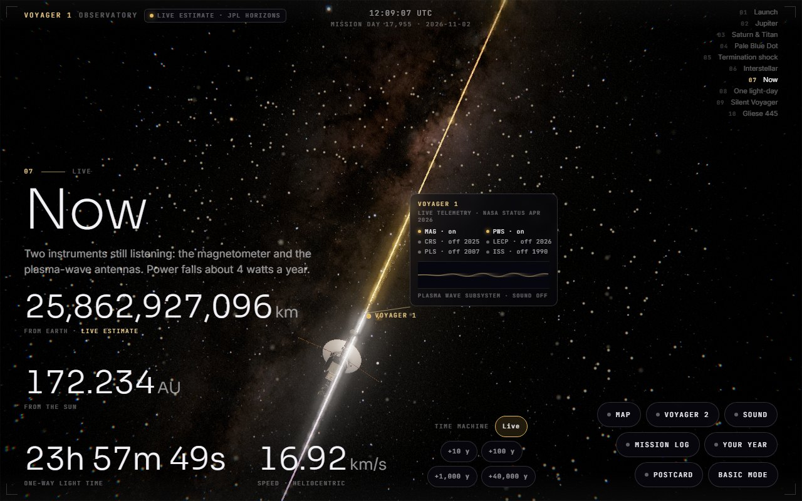
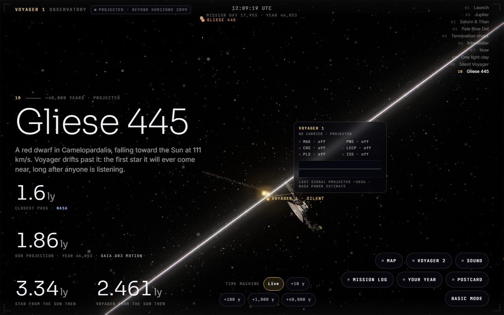
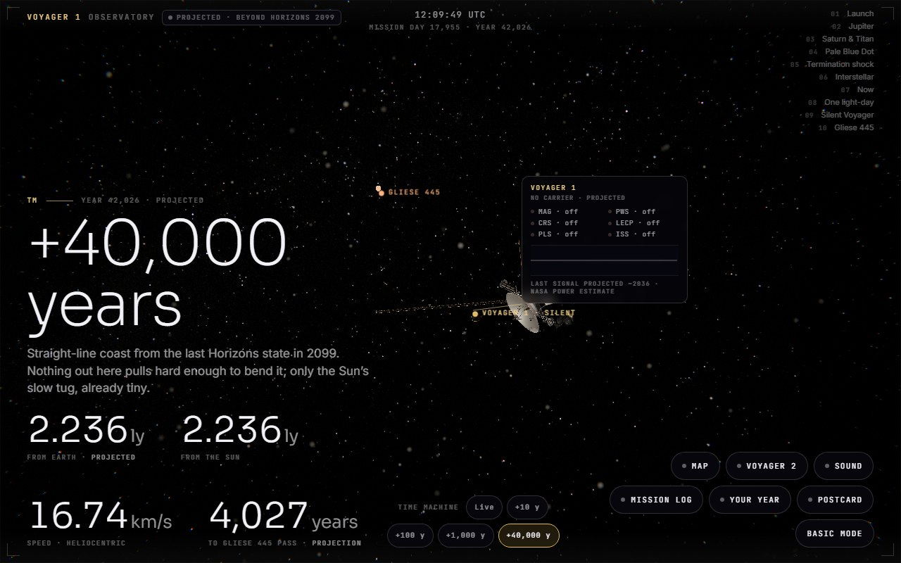
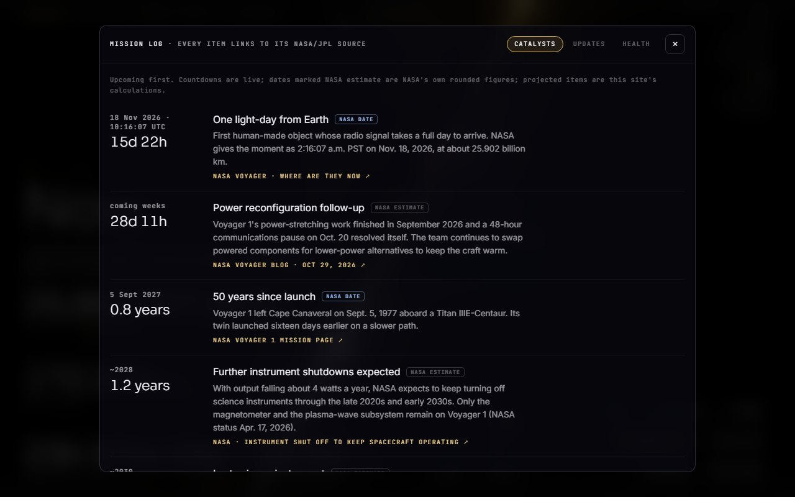
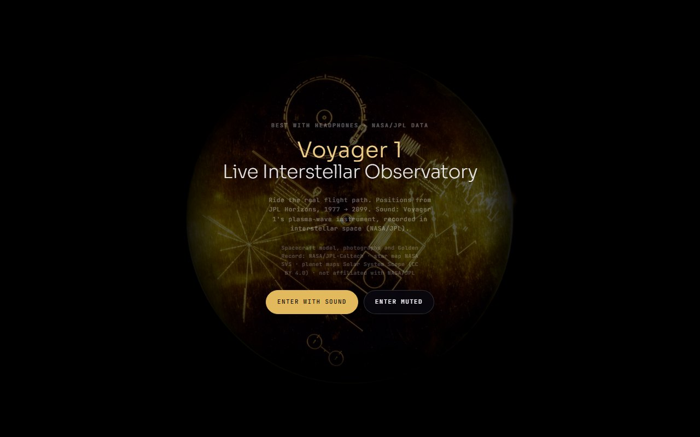
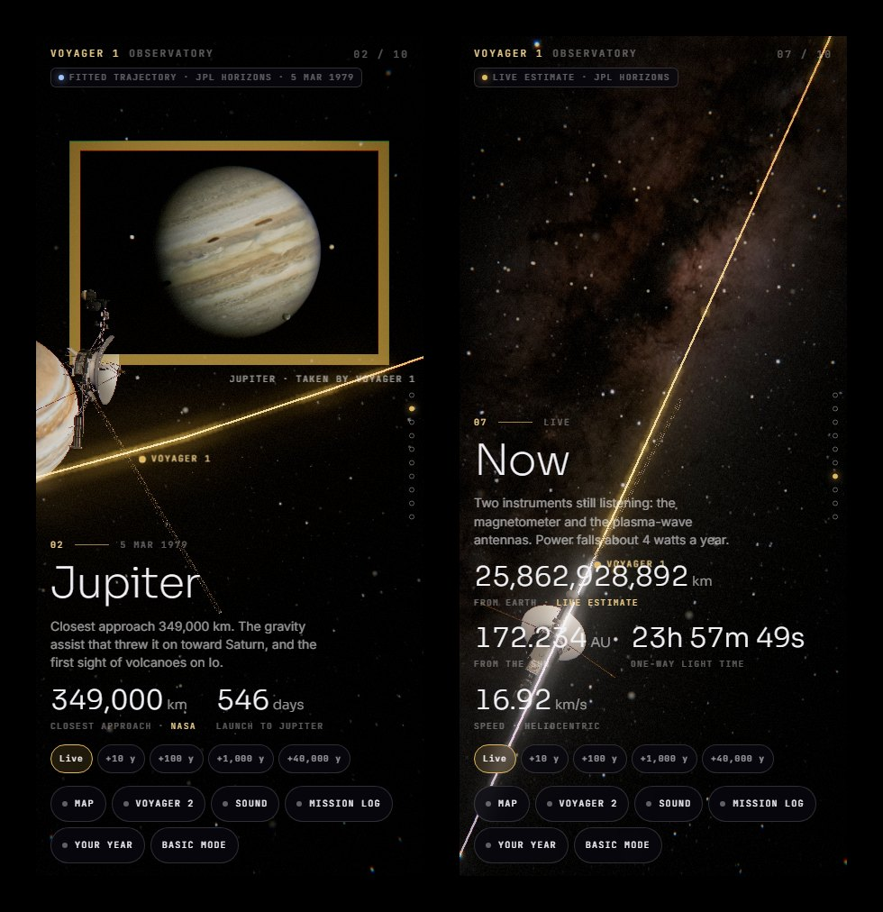
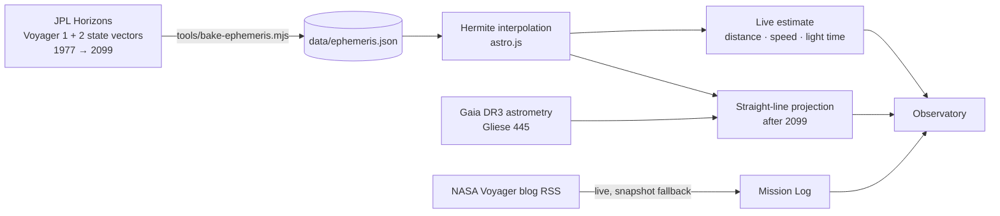

<div align="center">

<a href="https://voyagerterminal.space"></a>

# Voyager 1 · Live Interstellar Observatory

**Ride humanity's most distant object along its real flight path, from Cape Canaveral in 1977 to one light-day from Earth, and on for the next 40,000 years.**

[](https://voyagerterminal.space)
[](https://ssd.jpl.nasa.gov/horizons/)
[](https://threejs.org)
[](#run-it-locally)
[](LICENSE)

[**Open the observatory →**](https://voyagerterminal.space) &nbsp;·&nbsp; [Basic mode](https://voyagerterminal.space/basic.html) &nbsp;·&nbsp; [How the numbers work](#how-the-numbers-work)

</div>

<br>

> **18 Nov 2026 · 10:16:07 UTC.** Voyager 1 becomes the first human-made object whose radio signal takes a full day to reach Earth. The observatory counts down to it live, then keeps following the spacecraft long after NASA stops hearing it.

<br>

## The journey, in ten chapters

Scroll and the camera rides a glowing thread drawn from NASA/JPL's own trajectory. Each chapter stops at a real moment, with the photograph Voyager took there.

<table>
<tr>
<td width="50%"><br><sub><b>02 · Jupiter, 5 Mar 1979.</b> Closest approach 349,000 km, with Voyager's own photos of Jupiter and Io's volcanoes.</sub></td>
<td width="50%"><br><sub><b>04 · Pale Blue Dot, 14 Feb 1990.</b> Six billion kilometres out, the cameras turn back one last time.</sub></td>
</tr>
<tr>
<td width="50%"><br><sub><b>07 · Now.</b> Distance, speed and one-way light time, recomputed every frame from the fitted trajectory.</sub></td>
<td width="50%"><br><sub><b>10 · Gliese 445.</b> The first star Voyager will ever come near, about 40,000 years from now.</sub></td>
</tr>
</table>

| | Chapter | When |
|:-:|---|---|
| 01 | Launch | 5 Sep 1977 |
| 02 | Jupiter | 5 Mar 1979 |
| 03 | Saturn & Titan | 12 Nov 1980 |
| 04 | Pale Blue Dot | 14 Feb 1990 |
| 05 | Termination shock | 16 Dec 2004 |
| 06 | Interstellar | 25 Aug 2012 |
| 07 | **Now** | live |
| 08 | One light-day | 18 Nov 2026 |
| 09 | Silent Voyager | ~2036 · projected |
| 10 | Gliese 445 | ~40,000 years · projected |

<br>

## Inside the observatory

<table>
<tr>
<td width="50%"><br><sub><b>Time machine.</b> Jump +10, +100, +1,000 or +40,000 years. Every number switches to a <i>projected</i> label.</sub></td>
<td width="50%"><br><sub><b>Mission Log.</b> Upcoming catalysts with live countdowns, NASA's Voyager blog, and the instrument health board. Every item links to its source.</sub></td>
</tr>
<tr>
<td width="50%"><br><sub><b>The Golden Record gate.</b> Enter with sound for the UN greetings and Voyager's real plasma-wave recording from interstellar space.</sub></td>
<td width="50%" align="center"><br><sub><b>Built for phones too.</b> Touch scrolling, safe-area insets, one photo plate per chapter.</sub></td>
</tr>
</table>

**Also on board:** a solar-system map, Voyager 2 alongside its twin, *Your year* (where Voyager was the year you were born), a shareable postcard, a Deep Space Network dish tracker, and a plain-text basic mode for slow connections.

<br>

## How the numbers work



Every figure on screen carries one of three labels, so nobody mistakes a calculation for a measurement:

| Label | Meaning |
|---|---|
| **Live estimate** | Interpolated from JPL Horizons' fitted trajectory for this exact second |
| **NASA** | A figure quoted directly from a NASA or JPL page, linked |
| **Projected** | This site's own calculation beyond the data: after 2099, or after the transmitter falls silent around 2036 |

**Sanity check:** at NASA's official one-light-day instant the site puts Voyager 1 at 25.902 billion km from Earth, the same figure NASA publishes.

Planets use Standish orbital elements. Positions are true to scale in astronomical units; planet and spacecraft sizes are enlarged so they stay visible, and never hide the craft.

<br>

## Run it locally

No install and no build. It is static files and ES modules, so it needs any local web server:

```bash
git clone https://github.com/devhorfin/voyager-terminal.git
cd voyager-terminal
python -m http.server 5540
```

Then open <http://127.0.0.1:5540>.

Refresh the baked data when you want newer snapshots:

```bash
node tools/bake-ephemeris.mjs   # JPL Horizons → data/ephemeris.json
node tools/bake-news.mjs        # NASA Voyager blog → data/news.json
```

<details>
<summary><b>Project layout</b></summary>

```
index.html        page shell: HUD, chapters, overlays, time machine
app.js            scene, camera choreography, thread shader, HUD, sound
astro.js          ephemeris interpolation, planets, telemetry, Gliese 445
log.js            Mission Log: catalysts, NASA news, instrument health
basic.html        plain live-numbers page
data/             baked ephemeris, 9,096-star catalogue, catalysts, news
assets/           NASA spacecraft model, planet maps, photographs, audio
vendor/           three.js r170, pruned to the files the site imports
tools/            data bakers and build helpers
docs/screens/     the screenshots on this page, real renders of the site
```

</details>

<br>

## Credits

Everything you see is real imagery or real data. Nothing is drawn by hand or by code.

- **Spacecraft model, mission photographs, Golden Record and audio:** NASA / JPL-Caltech (public domain)
- **Trajectory:** [JPL Horizons](https://ssd.jpl.nasa.gov/horizons/) · **Star map:** NASA Scientific Visualization Studio · **Stars:** Yale Bright Star Catalogue · **Gliese 445:** Gaia DR3 via SIMBAD
- **Planet textures:** [Solar System Scope](https://www.solarsystemscope.com/textures/), CC BY 4.0
- **Rendering:** [three.js](https://threejs.org), MIT

Not affiliated with or endorsed by NASA or JPL.

<div align="center">
<br>
<sub>Code released under the <a href="LICENSE">MIT License</a>. Third-party assets keep their own licences, listed above.</sub>
<br><br>
<a href="https://voyagerterminal.space"><b>voyagerterminal.space</b></a>
</div>
